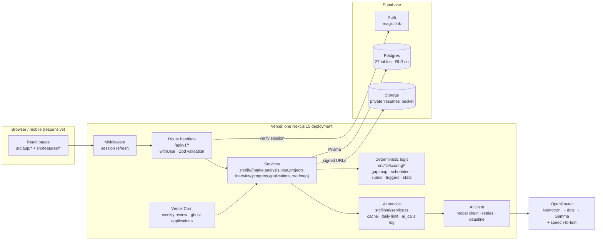
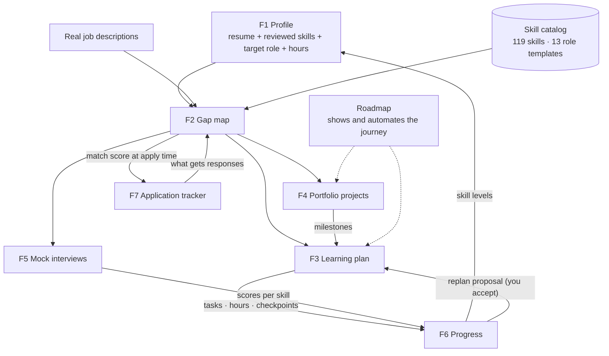
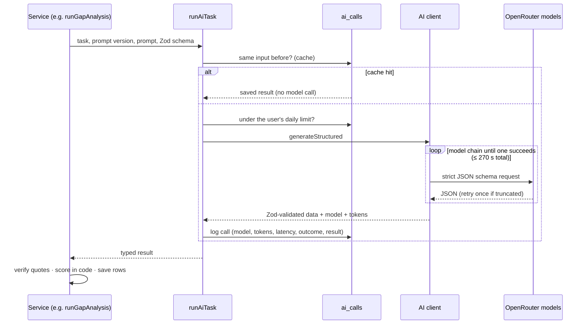

# CareerBuddy

**An AI career mentor that turns your resume and real job descriptions into an evidence-based plan for your next role.**

🔗 **Live:** [careerbuddy-ecru.vercel.app](https://careerbuddy-ecru.vercel.app)

CareerBuddy is for students looking for a first role and professionals changing direction (Frontend → Full Stack, .NET → Python, Software Engineer → AI Engineer…). It's not a chatbot. Every recommendation traces back to evidence: a line in your resume, a quote from a real job description, an interview score or an application outcome.

---

## Contents

1. [What the app does](#1-what-the-app-does)
2. [High-level design](#2-high-level-design)
3. [How the modules connect](#3-how-the-modules-connect)
4. [AI pipeline](#4-ai-pipeline)
5. [Tech stack](#5-tech-stack)
6. [Project structure](#6-project-structure)
7. [Getting started](#7-getting-started)
8. [Deploying to Vercel](#8-deploying-to-vercel)
9. [Security and privacy](#9-security-and-privacy)
10. [Scripts](#10-scripts)
11. [Documentation](#11-documentation)
12. [Contributing](#12-contributing)
13. [License](#13-license)

---

## 1. What the app does

| # | Module | Page | What you get |
|---|---|---|---|
| F1 | **Profile builder** | `/onboarding` | Upload a PDF/DOCX resume or paste it. The AI extracts your skills with verbatim quotes, marking each as *demonstrated* (used in real work) or *mentioned* (only listed). You review and correct the list, then set a target role, weekly hours and a 4/8/12/16-week timeline. |
| F2 | **Skill-gap map** | `/analyze`, `/gap-map` | Paste 1–5 real job descriptions. Each skill is weighted by how many JDs ask for it and whether it's required, then compared with your skills. You get a match score, Matched / Partial / Missing columns, a category, the required level and an effort estimate for each skill, and the resume and JD quote behind each skill. With fewer than 3 JDs, the matched role template fills in. Includes charts and an Excel export. |
| — | **Roadmap** | `/roadmap` | One visual view of your whole journey (Profile → Gap map → Plan → Projects → Interviews → Applications → Job-ready), with the status of each stage and the next best step. **Build my roadmap** creates any missing plan and project suggestions in one click. |
| F3 | **Learning plan** | `/plan` | A week-by-week plan that fits your hours, with prerequisites first and about 15% spare time each week. It uses curated resources only, so there are no made-up links. Each week has goals, exercises and a checkpoint. Code builds the schedule; the AI only writes the wording. |
| F4 | **Portfolio projects** | `/projects` | 2–4 projects chosen to cover your biggest gaps, each with scope, architecture, milestones, testing and deployment notes, and interview talking points. The milestones go straight into your plan. |
| F5 | **Mock interviews** | `/interview` | Questions generated from your target role and gaps (technical, coding, system design, behavioural, scenario). You see the rubric before answering. Each answer is scored per criterion, weak answers get a follow-up question, and you get a session report with recurring weaknesses. Voice answers are supported. |
| F6 | **Progress & replanning** | `/progress`, `/dashboard` | Tick off tasks, log hours and rate your skills. Your skill levels update from the evidence, with assessed scores outweighing self-ratings. When you fall behind, get ahead, master a skill or struggle with one, CareerBuddy proposes a revised plan with a diff of what changed. Nothing changes until you accept it. |
| F7 | **Application tracker** | `/applications` | Log applications on a board or in a table. The match score and role family fill in automatically from the linked job description. Response rates are shown per segment (source, seniority, match band…) with smoothing and a minimum of 5 applications. Applications with no activity for a while are marked ghosted automatically. |

**Design rules that apply everywhere:**

- **The AI extracts and writes; code decides.** Scores, schedules, priorities, rates and triggers are plain TypeScript functions with unit tests.
- **Evidence or it didn't happen.** Quotes the AI returns are checked against the source text. Unverifiable ones are dropped, and skills without proof can't be rated above intermediate.
- **Extract once.** A resume or JD with the same content is never sent to the AI twice.

---

## 2. High-level design



| Component | Responsibility | Why it's built this way |
|---|---|---|
| **Next.js (UI + API in one app)** | Pages, `/api/v1` route handlers, server components | One language, one deploy, shared Zod schemas. The backend is just route handlers; no separate server is needed (see [docs/ARCHITECTURE.md](docs/ARCHITECTURE.md) §3.2). |
| **Services** (`src/lib/<module>`) | One use case per function, e.g. `runGapAnalysis`, `createPlan`, `proposeReplan` | Callable from routes, server pages, cron jobs and tests alike |
| **Deterministic logic** (`src/lib/scoring`) | Every number the user sees | Explainable and unit-tested; the AI can't inflate a score |
| **AI service + client** (`src/lib/ai`) | The only path to the AI models | Caching, per-user limits, logging, fallbacks and timeouts in one place |
| **Supabase** | Postgres (via Prisma), Auth, Storage | One vendor for data, identity and files, all on the free tier |
| **Vercel Cron** | Weekly plan review and auto-ghosting applications | No extra infrastructure ([vercel.json](vercel.json)) |

---

## 3. How the modules connect



A typical journey:
1. Sign in with a magic link.
2. Upload your resume and review the extracted skills.
3. Paste 3 job descriptions to get your gap map.
4. Build your roadmap: plan and projects in one click.
5. Work through the weekly tasks.
6. Practise interviews.
7. Track your applications.

---

## 4. AI pipeline

Every AI call goes through `runAiTask()` ([src/lib/ai/service.ts](src/lib/ai/service.ts)):



- **Models:** free OpenRouter models. `nvidia/nemotron-3.5-super-vl:free` is primary, then `dots-studio/dots-3-note-preview:free`, then `google/gemma-4-31b-it:free` (JSON mode only, tried last). All are configurable through env vars.
- **Free-tier limits:** 50 requests a day for the whole account, or 1,000 after buying 10 credits. Each user is capped at `AI_DAILY_REQUEST_LIMIT` (default 20) model calls a day; cache hits are free. A full journey uses about 8 calls.
- **Latency:** 20–60 s per call on free models. AI routes allow up to 300 s, and the UI shows progress.
- **Privacy:** free models may log prompts. Use test resumes until a paid model that doesn't log prompts is configured.

---

## 5. Tech stack

| Layer | Choice |
|---|---|
| App | Next.js 15 (App Router) + TypeScript + Tailwind CSS 4 |
| Data | Supabase Postgres + Prisma 7 (`@prisma/adapter-pg`), pgvector available for later |
| Auth / files | Supabase Auth (magic link), Supabase Storage (private bucket, signed URLs) |
| AI | OpenRouter (free LLMs + speech-to-text), Zod structured outputs |
| Charts / export | Recharts, ExcelJS (in-app `.xlsx`), browser print to PDF |
| Parsing | `pdf-parse`, `mammoth` |
| Tests | Vitest (unit + mocked service tests) |
| Hosting | Vercel (functions up to 300 s, Cron) |

---

## 6. Project structure

```
src/
├─ app/                     pages and API routes
│  ├─ (pages)               dashboard, onboarding, analyze, gap-map, roadmap, plan,
│  │                        projects, interview, progress, applications, login
│  ├─ api/v1/               versioned JSON API (one folder per resource)
│  └─ api/cron/             weekly-review, ghost-applications (CRON_SECRET)
├─ features/<module>/       client components per module
├─ components/ui/           shared UI kit (Button, Card, Field, Badge, ScoreRing…)
├─ lib/
│  ├─ ai/                   client (model chain), service (cache/limits/log), prompts/*
│  ├─ scoring/              pure, tested logic: gap-map, schedule, coverage,
│  │                        interview, progress, replan, dashboard, applications, roadmap
│  ├─ intake/ analysis/ plan/ projects/ interview/ progress/ applications/ roadmap/
│  ├─ skills/               catalog matching (aliases, role templates)
│  ├─ api.ts auth.ts db.ts storage.ts supabase/
│  └─ middleware.ts         session refresh
prisma/                     schema, migrations, seed (skill catalog + role templates)
scripts/                    storage setup, CLI analysis, Excel/PDF report, DB diagram
tests/                      Vitest suites
docs/                       architecture, database design, feature plans
```

---

## 7. Getting started

### 7.1 Create the Supabase project

1. Create a project at [supabase.com](https://supabase.com) (free tier) and save the database password.
2. Copy `.env.example` to `.env` and fill it in:
   - **Connect → Connection string:**
     - *Transaction pooler* (port 6543) → `DATABASE_URL`
     - *Session pooler* (port 5432) → `DIRECT_URL`
   - **Project Settings → API Keys:**
     - Project URL → `NEXT_PUBLIC_SUPABASE_URL`
     - Publishable key → `NEXT_PUBLIC_SUPABASE_PUBLISHABLE_KEY`
     - Secret key → `SUPABASE_SECRET_KEY` (server-only; never expose it)
   - **OpenRouter ([openrouter.ai/keys](https://openrouter.ai/keys)):** `OPENROUTER_API_KEY` (server-only). The model settings in `.env.example` have sensible defaults.
   - **Cron:** `CRON_SECRET`, any long random string.
3. **Authentication → URL Configuration:**
   - Site URL: your app URL.
   - Redirect URLs: add `http://localhost:3000/auth/callback` and `https://<your-domain>/auth/callback`.

### 7.2 Database, seed data and storage

```bash
npm install
npm run db:deploy        # apply prisma/migrations (uses DIRECT_URL)
npm run db:seed          # skill catalog: 119 skills, 13 role templates, curated resources
npm run supabase:setup   # private "resumes" bucket (5 MB, PDF/DOCX)
npm run dev
```

Check the setup:
- `http://localhost:3000/api/health` should return `"db": "connected"` with every key set.
- Then sign in at `/login`.

When you change `prisma/schema.prisma`:
1. Run `npm run db:migrate -- --name <change>`.
2. Run `npm run docs:db` to regenerate the database diagram.
3. Commit both.

---

## 8. Deploying to Vercel

1. Import the GitHub repo in Vercel; it detects Next.js automatically.
2. Under **Settings → Environment Variables**, add every variable from `.env`. Set `NEXT_PUBLIC_SITE_URL` to the production URL.
3. Deploy. `npm run build` runs `prisma generate && next build`. Cron jobs are registered from [vercel.json](vercel.json).
4. Run `npm run db:deploy` against the production `DIRECT_URL` whenever there are new migrations.
5. Add the production `/auth/callback` URL to Supabase's redirect URLs.

Free-tier notes:
- Supabase pauses a project after 7 days of inactivity.
- Vercel Hobby is for non-commercial use.
- Supabase's built-in mailer sends only a few sign-in emails per hour. Configure custom SMTP before you have real users.

---

## 9. Security and privacy

- **Identity:** comes only from the verified Supabase session (`withUser` / `requireUser`). Every query is scoped by that user id, and other users' records return **404**. Isolation is covered by the end-to-end checks.
- **Database:** Row Level Security is on for every table with no policies, so Supabase's public Data API exposes nothing. The app reads and writes only through Prisma on the server.
- **Files:** stored in a private bucket under `{userId}/…`, accessed only through short-lived signed URLs after an ownership check. Audio is never stored.
- **Delete my data:** `DELETE /api/v1/me` removes stored files and the auth user, and every app row cascades with it.
- **Secrets:** server-only environment variables. Cron routes require `CRON_SECRET`.

---

## 10. Scripts

| Script | What it does |
|---|---|
| `npm run dev` | Local dev server |
| `npm run build` / `start` | Production build / serve |
| `npm test` | Vitest suite |
| `npm run lint` | ESLint |
| `npm run db:deploy` | Apply migrations |
| `npm run db:migrate` | Create a new migration (dev) |
| `npm run db:seed` | Seed the skill catalog and role templates |
| `npm run db:studio` | Prisma Studio |
| `npm run docs:db` | Regenerate [docs/DATABASE.md](docs/DATABASE.md) from the schema |
| `npm run supabase:setup` | Create or update the storage bucket |
| `npm run seed:check-links` | Check that curated resource links still resolve |
| `npm run analyze` / `report` | CLI gap analysis → Excel/PDF report (Python) |

---

## 11. Documentation

| Document | What's in it |
|---|---|
| [docs/DATABASE.md](docs/DATABASE.md) | **Database UML / ER diagrams** (overview + per module), table catalog, enums, migrations |
| [docs/ARCHITECTURE.md](docs/ARCHITECTURE.md) | Architecture evaluation and decision report: stack, LLMs, hosting, security, phases |
| [docs/HLD.html](docs/HLD.html) / [docs/LLD.html](docs/LLD.html) | High- and low-level design (open in a browser) |
| [docs/PLAN.md](docs/PLAN.md) | Original project plan |
| [docs/feature-plan/](docs/feature-plan/README.md) | Per-module specs (F1–F7) and implementation status |

---

## 12. Contributing

Contributions are welcome! Read [CONTRIBUTING.md](CONTRIBUTING.md) for setup and the pull request process, and the [Code of Conduct](CODE_OF_CONDUCT.md). Report security issues privately as described in [SECURITY.md](SECURITY.md).

---

## 13. License

[MIT](LICENSE) © 2026 Indhu Prakash K V
