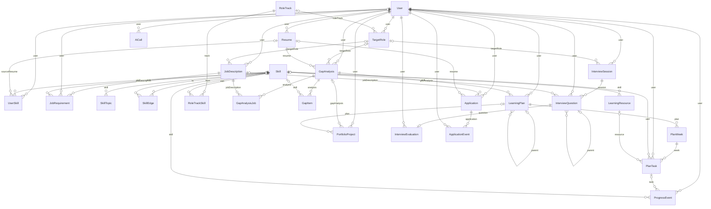
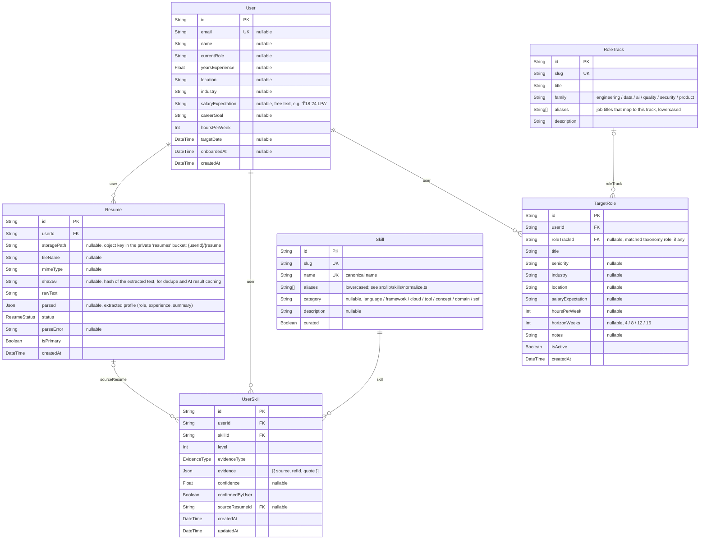
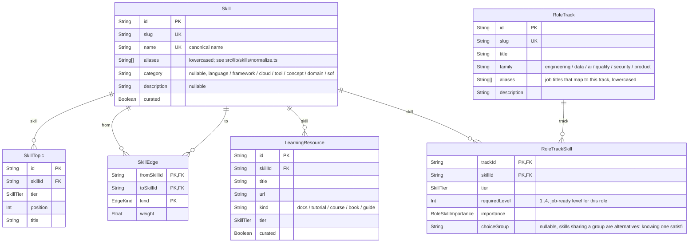
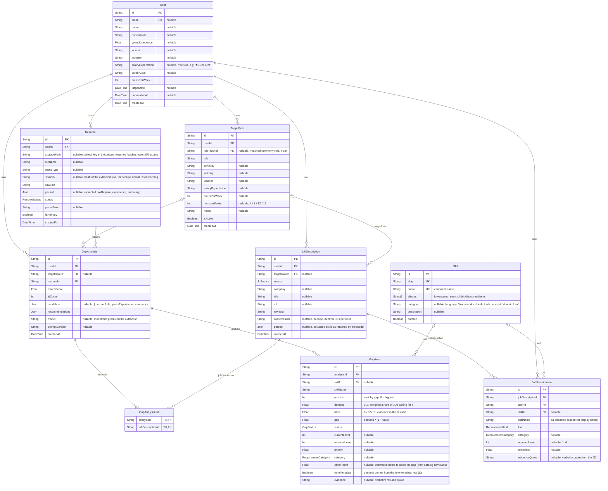
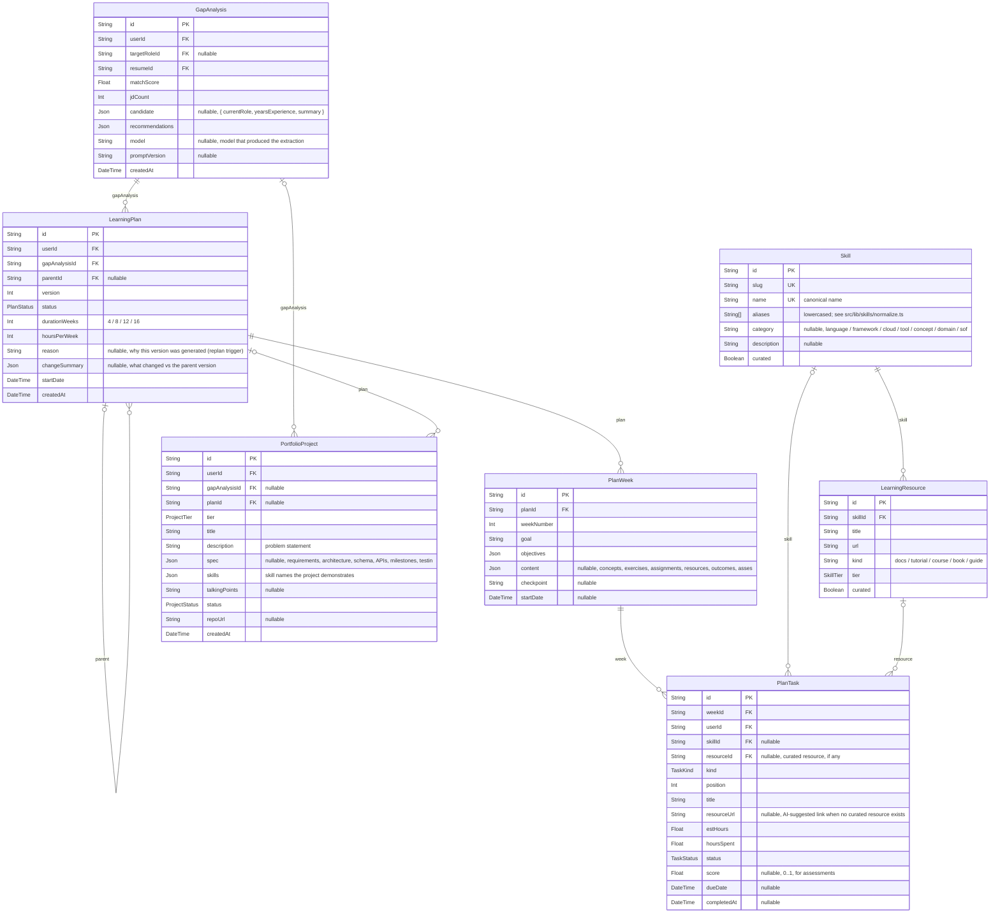
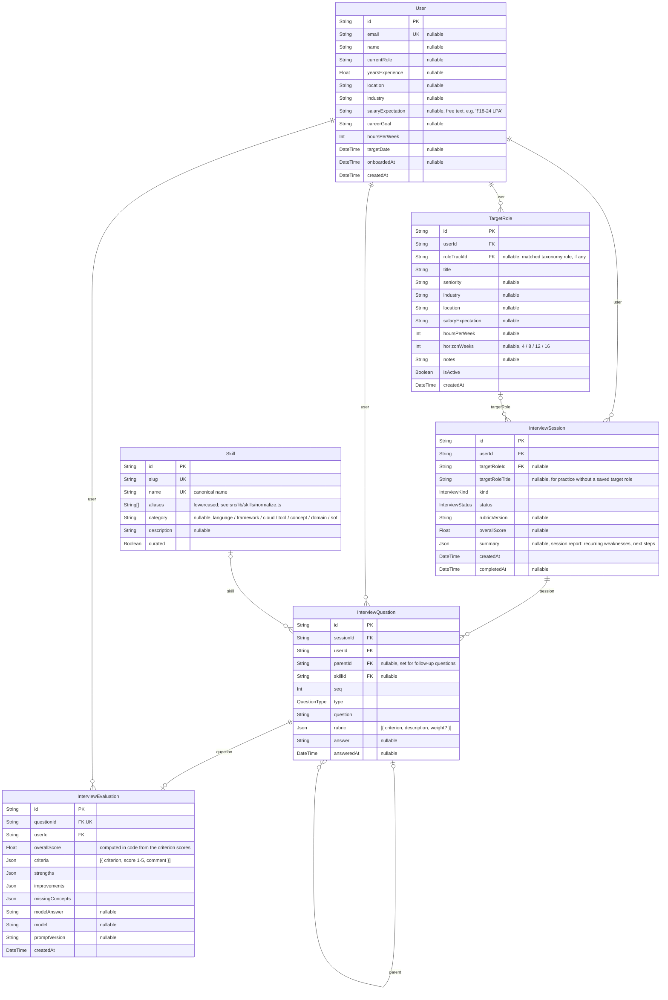
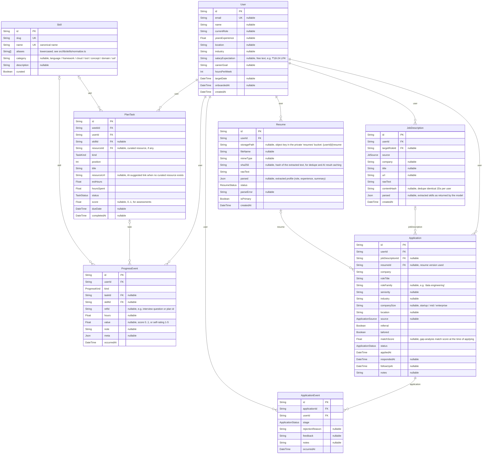
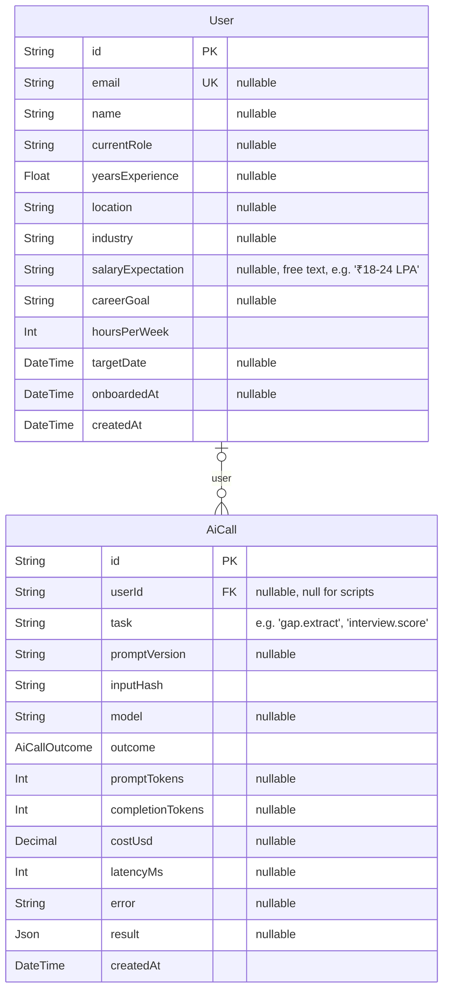

# CareerBuddy: Database Design

> Generated from [prisma/schema.prisma](../prisma/schema.prisma) by `npm run docs:db`. Don't edit by hand.

Supabase Postgres, accessed only from the server through Prisma 7. **26 tables**, **21 enums**.

- **Ownership:** every user-owned table carries `userId`, and every query is scoped to the signed-in user. Deleting a user cascades to all of their rows, and the `users` row itself cascades from Supabase's `auth.users`.
- **Row Level Security:** enabled on every table with no policies, so Supabase's public Data API can't read or write anything.
- **JSON columns** (`Json`) are JSONB, validated with Zod on write and read. They hold AI output that is always read as a whole (resume profile, week content, project specs, rubric scores).
- **Keys:** UUID primary keys. `users.id` equals the Supabase auth user id.

Notation (UML crow's foot): `||` exactly one, `|o` zero or one, `o{` zero or many. **PK** primary key, **FK** foreign key, **UK** unique.

## 1. Entity-relationship overview

All tables and relationships (attributes in §2).

## 2. Diagrams by module

### Users & intake (F1)

Profile, resumes, the skills inventory and target roles.

### Skill taxonomy (shared, seeded)

Canonical skills with aliases, prerequisites, topics, curated resources and role templates.

### Job descriptions & gap map (F2)

JDs, extracted requirements and the saved gap matrix.

### Learning plan & projects (F3, F4)

Versioned plans, weeks, tasks and portfolio projects.

### Mock interviews (F5)

Sessions, questions (with follow-ups) and evaluations.

### Progress & applications (F6, F7)

Append-only progress log, the application tracker and its event history.

### AI usage

Every AI request: model, tokens, latency, outcome; successful results double as a cache.

## 3. Table catalog

| Model | Table | Purpose | Unique keys |
|---|---|---|---|
| User | `users` | CareerBuddy: data model on Supabase Postgres. See PLAN.md §5 and ARCHITECTURE.md §7. Json columns are JSONB; validate them with Zod in src/lib before writing and after reading. Every user-owned table carries userId so queries can always be scoped to the session user. ───────────────────────────── Users ───────────────────────────── id is the Supabase auth user id (auth.users.id); the row is created on first sign-in. | email |
| Resume | `resumes` | — | (userId, sha256) |
| UserSkill | `user_skills` | The user's editable skills inventory. Levels: 0 none, 1 beginner, 2 intermediate, 3 advanced, 4 expert. Only demonstrated or assessed evidence may justify level 3+. | (userId, skillId) |
| TargetRole | `target_roles` | — | — |
| JobDescription | `job_descriptions` | — | (userId, contentHash) |
| JobRequirement | `job_requirements` | One skill requirement extracted from one JD, linked to the canonical skill. | — |
| Skill | `skills` | ─────────── Shared skill taxonomy (seeded from prisma/seed) ─────────── Canonical skill taxonomy, shared by all users. Curated rows come from prisma/seed; skills the LLM finds that aren't in the seed are added with curated = false. | slug, name |
| SkillTopic | `skill_topics` | What to learn for a skill, in order, at each tier. Feeds roadmap week content. | (skillId, tier, position) |
| SkillEdge | `skill_edges` | — | PK (fromSkillId, toSkillId, kind) |
| LearningResource | `learning_resources` | — | (skillId, url) |
| RoleTrack | `role_tracks` | Role template: the skills a role needs, grouped by learning tier. Used as a market prior when the user has fewer than 3 JDs, and to order the roadmap. | slug |
| RoleTrackSkill | `role_track_skills` | — | PK (trackId, skillId) |
| GapAnalysis | `gap_analyses` | One analysis run: a resume compared against one or more JDs. Scores are computed in code (src/lib/scoring/gap.ts); the LLM only extracts skills and evidence. | — |
| GapAnalysisJob | `gap_analysis_jobs` | — | PK (analysisId, jobDescriptionId) |
| GapItem | `gap_items` | One row of the skill-gap matrix. | (analysisId, position) |
| LearningPlan | `learning_plans` | Versioned: a replan creates a new row pointing at the previous version. | (gapAnalysisId, version) |
| PlanWeek | `plan_weeks` | — | (planId, weekNumber) |
| PlanTask | `plan_tasks` | — | — |
| PortfolioProject | `portfolio_projects` | — | — |
| InterviewSession | `interview_sessions` | — | — |
| InterviewQuestion | `interview_questions` | — | (sessionId, seq) |
| InterviewEvaluation | `interview_evaluations` | — | questionId |
| ProgressEvent | `progress_events` | Append-only activity log; dashboards and replan rules aggregate over it. | — |
| Application | `applications` | — | — |
| ApplicationEvent | `application_events` | Stage changes and outcomes; the stats in the insights view are computed from these. | — |
| AiCall | `ai_calls` | One row per AI task request (src/lib/ai/service.ts). Successful results are kept so identical requests are served from cache, which matters on the 50/day free tier. | — |

## 4. Enums

| Enum | Values |
|---|---|
| ResumeStatus | `uploaded`, `parsed`, `failed` |
| EvidenceType | `demonstrated`, `mentioned`, `self_reported`, `assessed` |
| JdSource | `pasted`, `file`, `url` |
| RequirementKind | `must`, `nice` |
| RequirementCategory | `must_have`, `good_to_have`, `advanced`, `domain` |
| SkillTier | `fundamental`, `intermediate`, `advanced` |
| EdgeKind | `prereq`, `related` |
| RoleSkillImportance | `core`, `recommended` |
| GapStatus | `matched`, `partial`, `missing` |
| PlanStatus | `draft`, `active`, `superseded`, `completed` |
| TaskKind | `learn`, `exercise`, `coding`, `assessment`, `project_milestone` |
| TaskStatus | `todo`, `doing`, `done`, `skipped`, `missed` |
| ProjectTier | `beginner`, `intermediate`, `advanced`, `production` |
| ProjectStatus | `suggested`, `in_progress`, `done`, `dropped` |
| InterviewKind | `technical`, `coding`, `system_design`, `behavioral`, `role_specific`, `scenario`, `mixed` |
| InterviewStatus | `in_progress`, `completed`, `abandoned` |
| QuestionType | `technical`, `coding`, `behavioral`, `system_design`, `scenario` |
| ProgressKind | `task_completed`, `task_missed`, `hours_logged`, `assessment_scored`, `interview_scored`, `project_milestone`, `skill_level_changed`, `plan_revised` |
| ApplicationStatus | `saved`, `applied`, `screening`, `interviewing`, `offer`, `rejected`, `ghosted`, `withdrawn` |
| ApplicationSource | `referral`, `job_board`, `company_site`, `recruiter`, `other` |
| AiCallOutcome | `ok`, `fallback`, `cache_hit`, `invalid`, `rate_limited`, `error`, `budget_exceeded` |

## 5. Migrations

Applied in order from [prisma/migrations](../prisma/migrations) with `npm run db:deploy`:

- `20261031120000_init`
- `20261031120100_supabase_security`
- `20261031130000_skill_taxonomy`
- `20261031140000_module_tables`
- `20261031150000_gap_item_effort`
