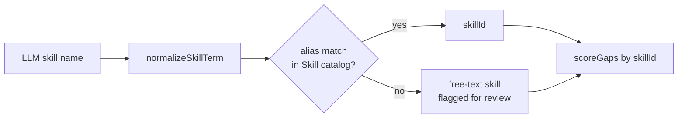

# F2: Skill-Gap Map from Real JDs

**Status:** Works, with weak spots · **Stack:** Next.js alone · **Back to:** [README](README.md)

## Goal

Compare the profile against 1–N real job descriptions and show a match score and Matched / Partial / Missing skills. Weight each skill by how many JDs ask for it and whether it's required, and back every claim with evidence from both the resume and the JDs.

## How it works today

1. One AI call ([gap-analysis.ts](../../src/lib/ai/prompts/gap-analysis.ts)) reads the resume and up to 5 JDs. It lists skills per JD as required or nice-to-have, and rates the resume per skill as 0 / 0.5 / 1 with a resume quote.
2. Code ([scoring/gap.ts](../../src/lib/scoring/gap.ts)) computes demand, gap and the match score, and sorts skills into Matched / Partial / Missing.
3. CLI path: `npm run analyze` → `npm run report` exports Excel/PDF (Python).

Scoring:

- `demand` = sum over JDs of (1 if required, 0.5 if nice-to-have) ÷ number of JDs
- `gap` = demand × (1 − have)
- The match score is the demand-weighted share of `have`

## Must-have items

| Item | Status |
|---|---|
| Resume + JD extraction in one call | Done |
| Deterministic demand, gap and match score | Done (tested) |
| Matched / Partial / Missing with resume quotes | Done |
| **Save** `JobDescription`, `JobRequirement`, `GapAnalysis`, `GapAnalysisJob`, `GapItem`. F3, F4 and F5 have nothing to build on until this exists. | Missing |
| **Catalog-based matching**: map both sides to `Skill` (119 seeded, with aliases) before scoring. Today a skill shows as Missing whenever the AI spells it differently on each side. | Missing |
| Unknown terms: keep them as free-text skills and flag them for review. Embeddings + `pgvector` can come later. | Missing |
| **Check resume quotes** against the resume text; drop or flag made-up quotes | Missing |
| **JD quotes** for each requirement (`JobRequirement.evidenceQuote`), checked against the JD text | Missing |
| **Role-template fallback** when there are fewer than 3 JDs: blend `RoleTrackSkill` demand with JD demand | Missing |
| **Category, required level and effort estimate** per gap item. F3's ordering uses importance × frequency ÷ effort. | Missing |
| Multiple JD paste boxes (add/remove), not just one box plus files | Missing |
| **Caching** by `Resume.sha256` / `JobDescription.contentHash`. `runAiTask` in `src/lib/ai/service.ts` adds request-level caching but isn't wired in yet. | Partly |
| Charts: category radar, demand × have matrix (install Recharts) | Missing |
| Excel/PDF export inside the app (see [cross-cutting §5](cross-cutting.md#5-reports-excelpdf)) | CLI only |

## Matching design

- Score on `skillId` when there is one and on the normalized name otherwise. This removes the "same spelling on both sides" dependency.
- Respect `RoleTrackSkill.choiceGroup`: knowing one alternative (e.g. React or Vue) satisfies the group.

## Data and API

- **Tables:** `JobDescription`, `JobRequirement`, `GapAnalysis`, `GapAnalysisJob`, `GapItem`, `Skill`, `RoleTrackSkill`
- `POST /api/v1/jobs`: add a JD (dedupe by hash)
- `POST /api/v1/analyze` (exists): read the saved resume, target role and JDs, and **save** the result
- `GET /api/v1/gap-analyses/:id`
- **UI:** `/gap-map`

## LLM vs code

| LLM | Code |
|---|---|
| Requirement and evidence extraction, recommendation text | Normalization, quote checks, template fallback, every score, rank and status |

## Stack assessment

| Need | Next.js | Python alternative | Verdict |
|---|---|---|---|
| Skill extraction | LLM + Zod (built) | spaCy / custom NER | LLM is better |
| Fuzzy matching | Alias table now; OpenRouter embeddings + `pgvector` later | sentence-transformers | JS + pgvector |
| Scoring | Pure TS (built) | pandas | JS is enough |
| JD from URL | `fetch` + HTML-to-text (public pages only) | BeautifulSoup / Playwright | JS; paste stays the main path |

## Done when

- The same skill spelled differently on each side ("k8s" vs "Kubernetes") counts as matched.
- With 1 JD and a matched role template, the gap list still includes the template's core skills.
- Every quote in a saved `GapItem` or `JobRequirement` appears in its source text.
- The analysis is saved and can be reopened without another LLM call.
