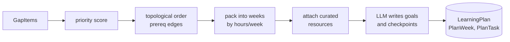

# F3: Week-by-Week Learning Plan

**Status:** Not started (schema ready) · **Stack:** Next.js alone · **Back to:** [README](README.md)

## Goal

A realistic plan that fits the user's weekly hours, puts prerequisites first, and gives every week goals, curated resources and a checkpoint.

## Depends on

- [F1](F1-intake.md): `hoursPerWeek`, timeline, current skill levels
- [F2](F2-skill-gap-map.md): saved `GapItem`s with priority, category, **effort estimate** and required level

## Must-have items

| Item | Notes |
|---|---|
| **Code-based scheduler** (`src/lib/scoring/schedule.ts`) | Pure function with unit tests |
| Rank gaps | priority = (importance × JD frequency) ÷ effort |
| Prerequisites first | Topological sort over `SkillEdge(kind = prereq)`, pulling in missing prerequisites |
| Fit to weekly hours | Greedy packing into `hoursPerWeek`, keeping ~15% spare. Anything that doesn't fit is deferred and shown to the user. |
| Task types | learn / exercise / coding / assessment / project_milestone (`TaskKind`) |
| **Curated resources only** | Pick from `LearningResource` by skill and tier, so the AI can't invent links. An AI-suggested link is used only when no curated one exists, and it's link-checked (`npm run seed:check-links`). |
| **AI writes the text, not the schedule** | For the skeleton the scheduler built, the LLM writes each week's goal, objectives, exercises and checkpoint |
| **Coverage check** | Every top-5 gap must appear in the plan (PLAN.md exit criterion). Fail loudly if not. |
| Versioning | `LearningPlan.version`, `parentId`, `reason`, `changeSummary`, used by F6 replans |
| API and `/plan` week view | Timeline, task checklist, hours bar per week |

## Scheduler flow

## Data and API

- **Tables:** `LearningPlan`, `PlanWeek`, `PlanTask`, `LearningResource`, `SkillEdge`, `SkillTopic`
- `POST /api/v1/plans` `{ gapAnalysisId }`
- `GET /api/v1/plans/:id`
- `PATCH /api/v1/tasks/:id` (status, hours, used by F6)

## LLM vs code

| LLM | Code |
|---|---|
| Week goal wording, exercises, checkpoint questions | Which skills, in what order, which week, how many hours, which resources |

LLMs regularly overfill weeks and ignore prerequisites. Scheduling in code keeps the plan testable and keeps replans predictable.

## Stack assessment

About 10–30 skills over 4–16 weeks is trivial for a greedy algorithm in TypeScript. A constraint solver (OR-Tools, Python) would be overkill. **No Python needed.**

## Done when

- No week exceeds `hoursPerWeek`.
- No task comes before its prerequisites.
- All top-5 gaps are covered, or the user is told explicitly which ones don't fit the timeline.
- Every resource link is curated or link-checked.
