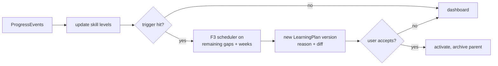

# F6: Progress Tracking That Adjusts the Plan

**Status:** Not started (schema ready) · **Stack:** Next.js alone · **Back to:** [README](README.md)

## Goal

Every completed task, logged hour, self-rating, assessment and interview score updates skill levels. The plan is regenerated when the user falls behind, gets ahead, masters a skill, or stays weak in one.

## Depends on

[F3](F3-learning-plan.md) (plan and tasks), [F4](F4-portfolio-projects.md) (milestones), [F5](F5-mock-interviews.md) (scores)

## Must-have items

| Item | Notes |
|---|---|
| Tick off tasks, log hours | `PATCH /api/v1/tasks/:id` writes `PlanTask` and a `ProgressEvent` |
| Self-rate each skill (1–5) | `ProgressEvent(kind = skill_level_changed)` with `evidenceType = self_reported` |
| Append-only event log | `ProgressEvent` is the single source for every dashboard and trigger |
| **Skill-level rule in code** (`src/lib/scoring/progress.ts`) | Weighted moving average of evidence: assessed > demonstrated > self-reported. One score can't swing a level. |
| **Replan triggers** (deterministic) | **Behind:** under 70% of planned hours for 2 weeks in a row. **Ahead:** over 120% with checkpoints passed. **Mastered:** level ≥ required, so drop remaining tasks. **Weak:** interview or assessment score under 50%, so add reinforcement. |
| **Replan = new plan version** | Rerun the F3 scheduler on the remaining gaps and weeks; save a new `LearningPlan` with `parentId`, `reason`, and a `changeSummary` diff |
| User approval | Show the diff and let the user accept it; never overwrite silently |
| Weekly check | Vercel Cron → `/api/cron/weekly-review`: mark missed tasks, evaluate triggers, queue reminders |
| Dashboard | Hours vs plan, streak, skill levels over time, readiness % |

## Replan flow

## Data and API

- **Tables:** `ProgressEvent`, `UserSkill`, `PlanTask`, `LearningPlan`
- `POST /api/v1/progress`
- `POST /api/v1/plans/:id/replan` (manual) and the cron route (automatic)
- `POST /api/v1/plans/:id/accept`
- `GET /api/v1/dashboard`

## LLM vs code

| LLM | Code |
|---|---|
| A plain-language explanation of what changed and why | Level updates, triggers, rescheduling, the diff |

## Stack assessment

Event aggregation is SQL, the rules are small TypeScript functions, and scheduling is Vercel Cron (or Supabase `pg_cron`). **No Python needed.**

## Done when

- Each trigger has a unit test with fixture events.
- A replan produces a new version whose diff names the added, removed and moved tasks.
- Interview scores from F5 change the matching skill's level.
