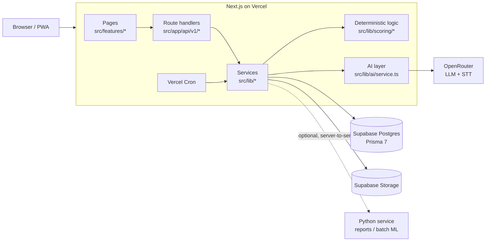
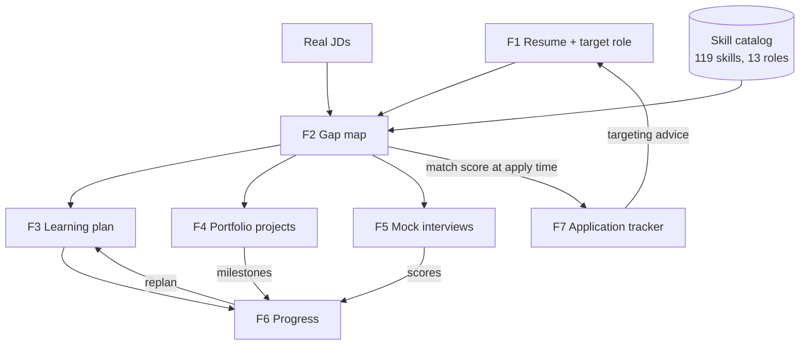

# CareerBuddy: Feature Plan and Stack Fit

What each feature needs, what is already built, and whether Next.js alone can do it or a Python FastAPI service is needed.

| | |
|---|---|
| **Date** | 2026-10-31 |
| **Version** | 1.1 (adds the code audit; replaces `docs/FEATURE_PLAN.html`) |
| **Related** | [PLAN.md](../../PLAN.md), [ARCHITECTURE.md](../../ARCHITECTURE.md), [prisma/schema.prisma](../../prisma/schema.prisma) |

## Module plans

| # | Module | Status | Next.js alone? | Plan |
|---|---|---|---|---|
| F1 | Resume and target-role intake | Built (see §5) | Yes | [F1-intake.md](F1-intake.md) |
| F2 | Skill-gap map from real JDs | Built (see §5) | Yes | [F2-skill-gap-map.md](F2-skill-gap-map.md) |
| F3 | Week-by-week learning plan | Built (see §5) | Yes | [F3-learning-plan.md](F3-learning-plan.md) |
| F4 | Portfolio project suggestions | Built (see §5) | Yes | [F4-portfolio-projects.md](F4-portfolio-projects.md) |
| F5 | Mock interviews scored on a rubric | Built; voice blocked by STT credit (see §5) | Yes | [F5-mock-interviews.md](F5-mock-interviews.md) |
| F6 | Progress tracking that adjusts the plan | Built (see §5) | Yes | [F6-progress-replan.md](F6-progress-replan.md) |
| F7 | Application tracker that learns | Built, stage 1 (see §5) | Yes (Python optional much later) | [F7-application-tracker.md](F7-application-tracker.md) |
| — | Cross-cutting: persistence, AI layer, privacy, reports, Python triggers | Built, except items in §5 | Yes | [cross-cutting.md](cross-cutting.md) |

## 1. Stack verdict

**Next.js alone covers all 7 modules. None of them needs FastAPI.**

The work in every module is one of three things:

- **LLM calls** (extracting, writing, judging). These are HTTP calls to OpenRouter and work the same from TypeScript or Python.
- **Deterministic logic** (scoring, scheduling, statistics). Small pure functions with unit tests. TypeScript is fine for this.
- **CRUD and UI**, which is what Next.js is for.

No module needs Python-only numeric libraries, self-hosted ML models, or long-running workers.

| | Count |
|---|---|
| Modules buildable in Next.js alone | **7 / 7** |
| Modules that require FastAPI | **0** |
| Optional Python add-ons | **2**: Excel/PDF reports (existing script), a cross-user F7 model (much later) |
| Platform limits to design around | **3**: 4.5 MB request body, function timeouts with ~50 s free-model latency, free-tier 50 requests/day |

Keep Next.js as the only application backend. If a trigger in [cross-cutting.md §6](cross-cutting.md#6-when-to-add-python) is hit later, add **one small Python service** for that job and call it server-to-server from Next.js. The browser only ever talks to Next.js, and auth stays there.

## 2. Target architecture

How the modules feed each other:

**Every arrow needs saved rows.** Nothing is written to the database today, which is why persistence is step 1 below.

## 3. Audit check (2026-10-31)

I checked each claim in the module-by-module review against the code.

| Claim | Result | Evidence |
|---|---|---|
| F1: no target-role, hours or timeline inputs | Confirmed | `/analyze` takes only a resume and JDs; `hoursPerWeek` appears only in `GET /api/v1/me`; there is no `/onboarding` page |
| F1: resume returns only role, years, summary | Confirmed | `candidate` in `GapExtractionSchema` ([gap-analysis.ts](../../src/lib/ai/prompts/gap-analysis.ts)) |
| F1/F2: nothing saved; storage helpers unused | Confirmed | No route imports `@/lib/db` or `@/lib/storage` (only `auth.ts` and `/api/health` use Prisma) |
| F2: skill catalog ignored, matching relies on identical spelling | Confirmed | `normalizeSkillTerm` is defined but never called; `scoreGaps` matches on `toLowerCase()` only |
| F2: evidence quotes not checked | Confirmed | [analyze.ts](../../src/lib/analysis/analyze.ts) passes the LLM output straight to scoring |
| F2: no JD quotes, category or effort | Confirmed | JD skills are `{ skill, required }` only |
| F2: no fallback for fewer than 3 JDs | Confirmed | |
| F2: single JD paste box | Confirmed | One `Textarea`; more JDs only as files (max 5) |
| F2: no content-hash caching | **Partly outdated** | `src/lib/ai/service.ts` (being written now) adds a cache keyed by a hash of the request, but no route uses it yet |
| F2: no charts, Recharts not installed | Confirmed | |
| F5: 3 hard-coded questions; target role never sent | Confirmed | `SAMPLE_QUESTIONS` in [PracticeInterview.tsx](../../src/features/interview/components/PracticeInterview.tsx); the API accepts `targetRole` but the UI doesn't send it |
| F5: rubric not shown before answering | Confirmed | The rubric appears only in the results |
| Cross: 1 of 17 tests fails | **Not reproduced** | `vitest run`: **17 / 17 pass**. The data issue behind it is real, though: `qa-automation-engineer`, `data-analyst` and `data-scientist` have **0 core advanced-tier skills**. The current test doesn't check for this. |
| Cross: AI usage not logged, no per-user limit | **Partly outdated** | `service.ts` adds `runAiTask` with `ai_calls` logging, a per-user daily limit (`AI_DAILY_REQUEST_LIMIT`, default 20) and caching. It isn't wired into any route yet. |
| Cross: synchronous ~50 s AI calls, no background jobs | Confirmed | |
| Cross: free models must not see real resumes | Confirmed | ARCHITECTURE.md §4.4 |

## 4. Build order

| Step | Work | Module plan | Unlocks |
|---|---|---|---|
| 0 | Wire `runAiTask` into the analyze and score routes; decide whether advanced-tier core skills are required per role, then fix the data or add the test | [cross-cutting](cross-cutting.md) | Cost control on the free tier |
| 1 | **Foundation:** onboarding (target role, hours/week, timeline), structured resume extraction, review step, save Resume / TargetRole / JobDescription / GapAnalysis | [F1](F1-intake.md), [F2](F2-skill-gap-map.md) | Everything else |
| 2 | **Harden F2:** catalog matching, quote checks, JD quotes, role-template fallback, effort and category, multi-JD UI, charts | [F2](F2-skill-gap-map.md) | Trustworthy input for F3/F4 |
| 3 | **F3 + F4 together** (same gap data) | [F3](F3-learning-plan.md), [F4](F4-portfolio-projects.md) | F6 |
| 4 | **F5:** question generation, saved sessions, rubric preview | [F5](F5-mock-interviews.md) | Interview scores for F6 |
| 5 | **F6:** progress, skill-level updates, replanning | [F6](F6-progress-replan.md) | Adaptive plan |
| any | **F7:** quick win, few dependencies | [F7](F7-application-tracker.md) | Targeting feedback |

> **Bottom line:** Next.js alone covers all seven modules. FastAPI would add a second deployment, duplicated schemas, CORS and cold starts without unlocking anything these features need. The real blocker is persistence, not the stack.

## 5. Implementation status (2026-10-31, after the build)

The §3 audit describes the code **before** this build. Every must-have item in F1–F7 now has code:

| Module | Pages | Main code |
|---|---|---|
| F1 | `/onboarding` (resume → review skills → target role + hours/timeline) | `src/lib/intake/*`, `/api/v1/resumes`, `/api/v1/skills`, `/api/v1/target-roles`, `/api/v1/role-tracks`, `PATCH /api/v1/me` |
| F2 | `/analyze`, `/gap-map`, `/gap-map/[id]` (charts, Excel export, print to PDF) | `src/lib/analysis/{jobs,run,view,quotes}.ts`, `src/lib/scoring/gap-map.ts` |
| F3 | `/plan`, `/plan/[id]` | `src/lib/scoring/schedule.ts`, `src/lib/plan/*`, `/api/v1/plans`, `PATCH /api/v1/tasks/:id` |
| F4 | `/projects` | `src/lib/scoring/coverage.ts`, `src/lib/projects/*`, `/api/v1/projects/*` |
| F5 | `/interview`, `/interview/[id]`, `/interview/practice` | `src/lib/interview/*`, `/api/v1/interviews/*` |
| F6 | `/progress`, `/dashboard` | `src/lib/scoring/{progress,replan,dashboard}.ts`, `src/lib/progress/*`, `/api/v1/plans/:id/{replan,accept,discard}`, `/api/cron/weekly-review` |
| F7 | `/applications` | `src/lib/scoring/applications.ts`, `src/lib/applications/*`, `/api/v1/applications/*`, `/api/cron/ghost-applications` |
| Cross | — | `runAiTask` on every AI call (cache, daily limit, `ai_calls`), `DELETE /api/v1/me` (delete my data), `vercel.json` crons |

**Still open (deliberately not built):**

- **Scanned PDFs:** they return `resume_text_too_short` and the user pastes text; there is no vision/OCR fallback. Sending PDFs to a vision model through OpenRouter is unverified and needs a paid model.
- **Voice answers:** OpenRouter speech-to-text needs a positive balance (HTTP 402), so live transcription is still untested.
- **JD import from a URL:** pasting text remains the only path.
- **Weekly cron:** it marks missed tasks and counts plans with triggers, but sends no reminders (there is no email or push channel) and doesn't auto-generate revisions, so each user's free AI quota isn't spent automatically.
- **Plan-change wording:** the replan explanation is built in code from the computed diff, not written by the LLM, which saves a request.
- **F7:** stages 2–3 (logistic score, cross-user model) and drag-and-drop on the board.
- **Seed data decision (§7):** three roles still have no core advanced-tier skills.
